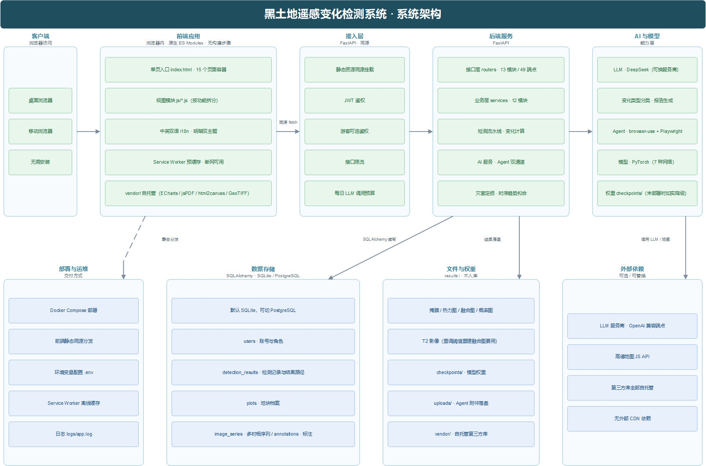
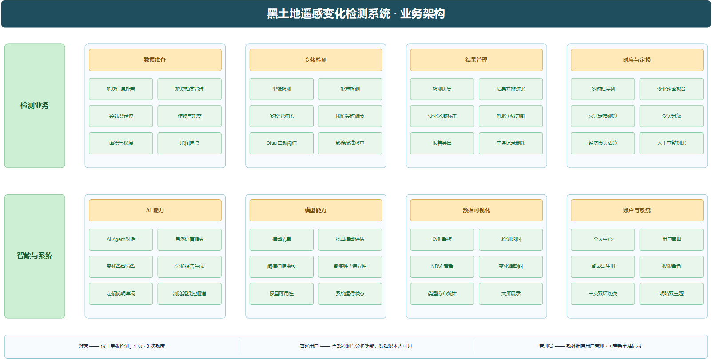

# BIT_CD · 黑土地遥感变化检测系统

面向东北黑土地保护的遥感变化检测平台。上传同一地块的前后两期影像，系统输出变化区域掩膜、
变化比例与统计，并在此基础上提供多模型对比、多时相趋势分析、农业灾害定损与 AI 辅助解读。

后端 FastAPI，前端原生 JavaScript 单页应用（无构建步骤），模型侧基于 PyTorch。



> 图是**脚本画的**，源码在 [docs/figures/](docs/figures/) —— 改 Python 重跑，
> 图和代码一起变，不用维护第二份元素清单。

---

## 功能



左侧导航共 15 个功能页：

| 页面 | 说明 |
|---|---|
| 地块信息 | 记录地块的经纬度、面积、作物等档案，供检测时关联 |
| 单张检测 | 上传 T1/T2 影像做一次变化检测，可多模型并排对比 |
| 批量检测 | 一次上传多组影像排队检测，支持中断后续跑 |
| 检测历史 | 全部检测记录，支持按模型/类型筛选、分页、单条删除 |
| 数据看板 | 检测总量、变化类型分布、模型使用统计、近 7 天趋势 |
| 时序分析 | 把同一地块的多期影像组织成序列，拟合变化速率与趋势 |
| 结果对比 | 两条记录并排比较掩膜/热力图/叠加图，并给出指标差异 |
| 模型评估 | 在各模型间做阈值扫描与批量评估 |
| 灾害定损 | 按受灾分级估算面积与经济损失，并对比人工查勘成本 |
| AI Agent | 自然语言驱动的智能体，可自行调用后端工具完成检测任务 |
| 检测地图 | 在地图上展示所有带坐标的检测记录 |
| 系统状态 | 模型信息、运行时长、CPU/内存、请求统计 |
| 个人中心 / 用户管理 | 账号信息、个人统计、管理员用户管理 |
| 关于 | 版本与更新记录 |

**中文 / English 双语**，界面右上角切换；**明暗双主题**。

---

## 技术栈

**后端** FastAPI · SQLAlchemy 2.0 · Alembic · SQLite（可换 PostgreSQL）· JWT 鉴权 · slowapi 限流

**前端** 原生 JavaScript ES Modules（无打包器）· ECharts（图表）· 高德地图 JS API

**模型** PyTorch · 见下方「检测模型」

**AI** DeepSeek（`deepseek-v4-flash`）— 变化类型分类、分析报告、定损说明草稿。
服务商可通过环境变量切换，三个消费方都走 OpenAI 兼容端点，换家不用改代码。

**Agent** browser-use + Playwright — 浏览器操控通道；另有一条直接调用后端工具的工具通道

---

## 快速开始

### 本地运行

```bash
# 1. 依赖
pip install -r requirements.txt
python -m playwright install chromium     # Agent 功能需要

# 2. 配置
cp .env.example .env                       # 然后按注释填入真实值

# 3. 启动（同时把 frontend/ 挂在 / 上）
python api.py
```

打开 <http://localhost:8000>。首次启动会自动建库并创建 `admin` 账号，
密码取自 `.env` 的 `ADMIN_DEFAULT_PASSWORD`。

### 测试

```bash
pytest                              # 单元/接口测试，不需要起服务
```

**推代码和提 PR 时会自动跑这套测试**（[.github/workflows/tests.yml](.github/workflows/tests.yml)）。
CI 里没有 `checkpoints/`（不入库），workflow 会造三个空占位文件 —— 可用性测试只做
`os.path.exists`，检测类测试的推理是 mock 的，不会真去加载权重。

下面几个是**跑真实系统**的检查脚本，除注明外都需要先 `python api.py`：

| 脚本 | 覆盖什么 | 代价 |
|---|---|---|
| `scripts/smoke_test.py` | 约 30 项接口：检测、评估、历史、标注、鉴权、限流 | 本地签发令牌；自清理 |
| `scripts/api_misc_test.py` | 地块档案 / 时序序列 / 灾害定损 —— 冒烟没覆盖的三块 | 会造记录，跑完自删 |
| `scripts/agent_tools_test.py` | Agent 七个工具的**实际执行**，含附件白名单与归属过滤两条安全边界 | 不起服务（进程内直调）；零 LLM 调用 |
| `scripts/agent_e2e_test.py` | Agent 端到端闭环（意图→执行→回灌→汇报） | **花 LLM 调用**，每条 1~3 次 |
| `scripts/browser_test.py` | 批量检测 / 地图底图 / 导出 CSV+PDF —— 只能靠真浏览器验的部分 | 需要 Playwright；会造记录，跑完自删 |
| `scripts/eval_agent_intent.py` | Agent 意图解析准确率（只问「选哪个工具」，不执行） | 每条用例一次 LLM 调用 |

维护用：

```bash
python scripts/clean_results.py            # 看看 results/ 里有多少没人引用的文件
python scripts/clean_results.py --delete   # 清掉
```

> `results/` 只增不减 —— 删检测记录并不会删文件。判据不能只看数据库的 URL
> 字段：`_t2.png` 不记录在任何字段里，是靠 `score_url` 推出来的（重建融合图要用），
> 照「URL 里没有就删」会把它干掉。脚本已把这类推导文件算进保留集。

> `pytest.ini` 把收集范围限定在 `tests/` 是**必需的**：`scripts/` 下这些脚本的
> 文件名都匹配 pytest 默认的 `*_test.py`，而它们会打真实服务器、造真实记录，
> 不排除的话裸跑 `pytest` 会在收集阶段直接崩。

### Docker 部署

```bash
cp .env.example .env       # 按注释填好各项
DEPLOY_HOST=your.server.ip bash deploy.sh
```

`.env` / `.env.production` 都在 `.gitignore` 里，不会随仓库分发 —— 部署前需自行创建。

`deploy.sh` 的服务器地址通过环境变量 `DEPLOY_HOST` 传入，脚本里不写死。

---

## 配置

全部通过环境变量（`.env`，模板见 `.env.example`）：

| 变量 | 用途 |
|---|---|
| `JWT_SECRET` | 令牌签名密钥。未设置时启动生成随机值，**重启后所有用户需重新登录** |
| `ADMIN_DEFAULT_PASSWORD` | 管理员初始密码，仅首次建库时使用 |
| `USER_RESET_PASSWORD` | 管理员重置用户密码时的默认值 |
| `LLM_API_KEY` | LLM 服务商密钥。缺失时 AI 相关功能不可用，其余功能正常 |
| `LLM_BASE_URL` / `LLM_MODEL` / `LLM_AGENT_MODEL` | 服务商与模型。默认 DeepSeek |
| `LLM_DAILY_CALL_LIMIT` | 每日调用次数上限（默认 500，0 = 不限制），用来拦住失控的循环调用 |
| `AMAP_WEB_KEY` | 高德地图。缺失时地图页降级 |
| `ALLOWED_ORIGINS` | CORS 白名单，逗号分隔 |
| `DATABASE_URL` | 默认 `sqlite:///./blackland.db` |
| `AGENT_*` | Agent 的目标地址、注入账号、无头模式、最大步数 |

前端另有一份不入库的本地配置 `frontend/js/config.local.js`（浏览器端高德 Key），
模板见 `frontend/js/config.local.example.js`。

---

## 检测模型

内置 7 种，可在检测页选择，也可勾选多个做并排对比：

| ID | 说明 |
|---|---|
| `BIT` | BIT Transformer，默认推荐 |
| `DIFF` | 像素级差分基准，不依赖权重 |
| `FC_SIAM_DIFF` | 全卷积孪生差分 |
| `SNUNET` | SNUNet-CD |
| `CHANGEFORMER` | ChangeFormer |
| `AFCF3D` | AFCF3D-Net |
| `BIT_LuojiaSET` | 在 LuojiaSET-CLCD 上训练的 BIT |

**权重不随仓库分发。** 放入 `checkpoints/<模型ID>/best_ckpt.pt` 即被识别。
缺权重的模型不会报错，会退回 ImageNet 特征初始化（检测结果明显变差），
`/detect/models` 接口会如实报告哪些模型的权重可用。

大量权重文件可用 `upload_checkpoints.sh` 批量上传；该脚本的服务器地址同样
来自环境变量：

```bash
DEPLOY_HOST=root@your.server.ip ./upload_checkpoints.sh
```

---

## 深入阅读

| 文档 | 讲什么 |
|---|---|
| [docs/ARCHITECTURE.md](docs/ARCHITECTURE.md) | 系统架构：后端分层、数据模型、鉴权与权限面、检测流水线、外部依赖 |
| [docs/业务流程.md](docs/业务流程.md) | 用户从「有一块地」到「得出结论」实际走的那条路，以及四条最容易踩的数据契约 |
| [docs/需求规格.md](docs/需求规格.md) | **逆向整理**的需求基线：功能需求编号、验收标准、需求—实现追溯矩阵 |
| [docs/测试报告.md](docs/测试报告.md) | 六种测试手段的结果、本轮发现并处理的缺陷、明确未覆盖的范围 |
| [docs/上线方案.md](docs/上线方案.md) | 部署步骤、配置项、验证清单、回滚与运维、已知限制 |
| [docs/AGENT.md](docs/AGENT.md) | Agent 的两条通道（工具 / 浏览器）、7 个工具清单、提示词设计、模型选型约束 |
| [docs/figures/](docs/figures/) | 系统架构图与业务架构图的**源码**与 Visio 源文件 —— 图是脚本画的，改 Python 重跑 |

---

## 项目结构

```
backend/app/
  core/        配置、鉴权、限流、验证码、时间处理
  models/      SQLAlchemy 表定义
  routers/     接口层（detect / history / agent / disaster / series / ai …）
  schemas/     Pydantic 入参出参
  services/    业务逻辑（检测流水线、AI、Agent、定损、趋势拟合）
frontend/
  index.html   单页入口（15 个页面容器都在这一个文件里）
  css/         全部样式，含主题令牌
  js/          按功能拆分的 ES 模块
  vendor/      自托管第三方库（ECharts / jsPDF / html2canvas / GeoTIFF）与字体
core/          模型推理框架与数据配置
models/        网络结构定义
checkpoints/   模型权重（不入库）
scripts/       维护与冒烟脚本
tests/         测试
alembic/       数据库迁移
```

前端第三方库全部自托管在 `frontend/vendor/`，不依赖任何外部 CDN；
Service Worker 的预缓存清单与之同步，断网也能打开。

---

## 已知限制

- **地图底图需要高德 Key 的域名白名单放行**。域名未授权时高德返回
  `INVALID_USER_DOMAIN`，且不会抛出任何可用的 API 信号（`new AMap.Map()` 不报错、
  `complete` 事件照常触发，画布只是空白）。前端对这种情况做了兜底提示，但根因要在
  高德控制台配置。
- **灾害定损的假设参数（亩产、单价、减产比例）默认值是示例值**，界面上已标注。
  实际测算前应按当地统计年鉴或保险条款替换。
- **游客额度记在浏览器 localStorage 里**，后端只做 30 次/分钟的限流，不做总量约束。
- AI 相关功能依赖所配 LLM 服务商的可用性与账号配额，接口不可用时仅这些功能降级。
- **Agent 用途的模型必须同时支持视觉与 Function Calling**。当前默认
  `deepseek-v4-flash`（实测两项都支持）。换模型时注意 `deepseek-v4-pro`
  **不接受图片输入**，会让 Agent 失效。

---

## 许可

仅供学习与竞赛使用。
